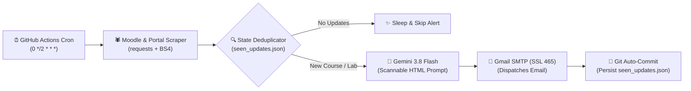

# 🎓 Academic Smart System

> Serverless academic automation platform for engineering students. Tracks newly posted courses, labs (**TP**), and directed work (**TD**) using BeautifulSoup, generates clean, scannable HTML email notifications via **Gemini 3.8 Flash**, and features a mobile-responsive **n8n-style web dashboard**.

---

## 🌟 Key Features

1. **Course & Lab Tracker (`main.py`)**:
   - **Real-Time Web Scraper**: Crawls Moodle and university portals with `requests` + `BeautifulSoup4` to detect new lecture slides (*Cours*), laboratory assignments (*TP*), and directed work (*TD*).
   - **State-Aware Deduplication (`seen_updates.json`)**: Compares scraped items against a persistent state file. **Only triggers alerts when a brand-new course or lab is published**, completely eliminating inbox spam.
   - **Automated State Persistence**: GitHub Actions automatically commits and pushes updated state back to the repository (`[skip ci]`).

2. **Gemini 3.8 Flash Scannable HTML Alerts**:
   - Direct HTTP POST calls to the Gemini REST API (`gemini-3.8-flash`) with automatic 3x retry on 503 overload spikes.
   - Generates high-contrast, scannable HTML email cards highlighting:
     - 🏷️ **Type Badge**: `[COURS]` (Blue), `[TP / LAB]` (Emerald Green), `[TD]` (Purple)
     - 📘 **Course / Lab Name** & Module Title
     - ⏰ **Submission Deadlines**
     - 🔗 **Direct One-Click Button** to the Moodle resource
     - 🌐 **Concise Action Summary** in English and Arabic

3. **Mobile-Responsive n8n-Style Dashboard (`index.html`)**:
   - **PWA (Progressive Web App)**: Add directly to iOS / Android home screen as a standalone mobile app.
   - **Interactive Node Canvas**: Visual n8n workflow canvas with pan/zoom and animated SVG cables.
   - **Slide-out Node Inspector**: Tap any node to inspect parameters, configuration, and JSON payloads (Desktop drawer & Mobile bottom sheet).
   - **Live Terminal & Simulation**: macOS-style terminal console with real-time log streaming simulation.
   - **Tracked Courses & Labs Browser**: Real-time filtering, instant search, and direct resource links syncing directly with `seen_updates.json`.

---

## 🏗️ Architecture & Automation Flow



---

## 📱 Mobile-First n8n Web App

The dashboard is designed as a minimalist, dark-themed progressive web app for GitHub Pages:

- **Workflow Nodes**: Visualizes the serverless pipeline (Triggers, Scrapers, State Gates, LLM, SMTP, and Git).
- **Live Logs & History**: Real-time terminal log viewer, success metrics, and interactive execution simulator.
- **Tracked Courses/Labs**: Interactive cards with badges, deadlines, search bar, and one-click direct links.

### Adding to Phone Home Screen (PWA)
1. Navigate to the GitHub Pages URL on your mobile browser (Safari on iOS or Chrome on Android).
2. **iOS**: Tap the **Share** button (⎙) ➔ select **Add to Home Screen**.
3. **Android**: Tap the menu (⋮) ➔ select **Install app** or **Add to Home screen**.

---

## ⚙️ Configuration & GitHub Secrets

Add the following secrets in your repository under **Settings ➔ Secrets and variables ➔ Actions**:

| Secret Name | Required | Description |
| :--- | :---: | :--- |
| `GEMINI_API_KEY` | **Yes** | Google Gemini API Key (used for `gemini-3.8-flash` REST endpoint). |
| `GMAIL_USER` | **Yes** | Sender and recipient Gmail address. |
| `GMAIL_APP_PASSWORD` | **Yes** | 16-character [Google App Password](https://myaccount.google.com/apppasswords). |
| `PORTAL_URL` | *Optional* | Target university Moodle / Portal URL (e.g., `https://moodle.univ.edu`). |
| `MOODLE_USERNAME` | *Optional* | Moodle login username (if portal requires authentication). |
| `MOODLE_PASSWORD` | *Optional* | Moodle login password. |

> **Note**: If `PORTAL_URL` is omitted or temporarily unreachable, the system automatically uses a high-fidelity academic simulation feed so local tests and workflow dispatch runs succeed without interruption.

---

## 🚀 Local Development & Testing

1. **Clone and setup virtual environment**:
   ```bash
   python3 -m venv .venv
   source .venv/bin/activate
   pip install -r requirements.txt
   ```

2. **Run Tracker locally**:
   ```bash
   python .github/workflows/main.py
   ```

3. **Preview Web App**:
   Open `index.html` directly in your browser or run a lightweight local server:
   ```bash
   python3 -m http.server 8080
   ```
   Visit `http://localhost:8080` on desktop or your mobile device.

---

## 📄 License
MIT © 2026 Houssem Eddine Serai
